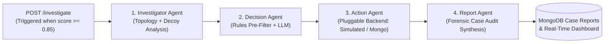

# FraudGuard AI — Investigation Layer Service (`agent-service/`)

**Member C Work Scope**: Autonomous Multi-Agent Investigation Pipeline (Layer 3)  
**Author**: Shruti Jaggi (Member C)  
**Base URL**: `http://127.0.0.1:8001`  
**Swagger UI**: `http://127.0.0.1:8001/docs`

---

## 1. System Overview

FraudGuard AI detects UPI mule-account fraud rings.
- **Layer 1 (Member A)**: Mock UPI application showing real-time risk warning banners before payment authorization.
- **Layer 2 (Member B)**: GraphSAGE + XGBoost blended model scoring accounts (running on port `8080`). Accounts with risk scores $\ge 0.85$ trigger deep investigation.
- **Layer 3 (Member C, this service)**: Autonomous 4-agent LangGraph investigation pipeline running on local Ollama (`llama3.2:latest`) exposed as `POST /investigate` on port `8001`.



---

## 2. Multi-Agent Pipeline Architecture

### Agent 1: Investigator Agent (`nodes/investigator.py`)
- Analyzes account tenure, KYC tier, velocity, retained balance, and multi-hop graph neighborhood.
- **Discrimination Engine**: Distinguishes genuine fraud rings (`chain`, `star`, `cycle`, `fan_out`, `hybrid`) from innocent look-alike decoys (`family_group`, `forwarding_chain`, `merchant_hub`, `payroll_fanout`).
- **Model Divergence Analysis**: Detects when GraphSAGE (`sage_score` $\ge 0.85$) over-flags accounts due to graph degree/proximity while tabular XGBoost (`xgb_score` $< 0.30$) and organic tenure indicate an innocent false alarm.

### Agent 2: Hybrid Decision Agent (`nodes/decision.py`)
- **Stage 1 (Hard Business Rules Pre-Filter)**:
  - Auto-blocks confirmed mule-chains with new tenure ($< 30$ days), near-zero balance retention ($< 5\%$), and confirmed aggregator sink hops.
  - Clears verified decoys with established tenure ($> 90$ days), full biometric KYC, and organic balance.
- **Stage 2 (LLM Forensic Judgment)**:
  - Evaluates borderline or over-flagged accounts where precision at the 0.85 flag is $\sim 0.43$.
  - Strictly outputs one of: `auto_block`, `escalate`, `clear` with structured rationale.

### Agent 3: Action Agent (`nodes/action.py`)
- Pluggable backends: `SimulatedActionBackend` (default for local runs) and `MongoActionBackend` (direct MongoDB updates).
- Action State Mapping:
  - `auto_block` $\rightarrow$ `account_status: "account_frozen"`, revokes UPI handle, applies NPCI debit freeze, blacklists device.
  - `escalate` $\rightarrow$ `account_status: "flagged_for_review"`, applies 30-min hold, issues biometric step-up OTP challenge.
  - `clear` $\rightarrow$ `account_status: "cleared"`, authorizes standard payments, logs verified benign activity.
- **Safety**: Never modifies Member B's precomputed risk scores.

### Agent 4: Report Agent (`nodes/report.py`)
- Synthesizes an executive, human-readable forensic audit report detailing target account, KYC, model score breakdown, topology identified, evidence trail, enforcement verdict, and ISO 8601 timestamp.

---

## 3. API Contract Specifications

### 3.1 `POST /investigate` (Contract 4.1)
- **Method**: `POST`
- **Path**: `/investigate`
- **Query Parameter**: `use_cache=true` *(optional: instant pre-cached response for live presentation reliability)*

**Request**:
```json
{
  "account_id": "C1000039615"
}
```
*(Accepts dataset account IDs like `C1000039615` or `acc_chain_016_4`, and defensively strips `@upi` suffix and handles case-insensitivity).*

**Response (200 OK)**:
```json
{
  "account_id": "C1000039615",
  "decision": "auto_block",
  "action_taken": "UPI ID 'c1000039615@upi' revoked; Immediate debit freeze applied on NPCI switch; Device 'DEV_EMULATOR_041' blacklisted across inter-bank fraud registry.",
  "report": "=== FRAUDGUARD AI CASE AUDIT REPORT ===\nTarget Account : C1000039615 (c1000039615@upi)\nAccount Age    : 8 days | KYC Status: PARTIAL_MINIMUM_OTP\n..."
}
```

**Errors**:
- Unknown account $\rightarrow$ `404 Not Found` (`{"detail": "Account '...' not found in data repository."}`)
- Missing or empty `account_id` $\rightarrow$ `422 Unprocessable Entity`
- Never returns `500` for an invalid ID.

---

## 4. Configuration & Environment Variables

All settings are unified in `config.py` (zero scattered magic numbers):

| Variable | Default | Description |
| :--- | :--- | :--- |
| `PORT` | `8001` | Service HTTP port (defended against port 8080 used by Member B) |
| `OLLAMA_BASE_URL` | `http://localhost:11434` | Ollama local inference endpoint |
| `OLLAMA_MODEL` | `llama3.2:latest` | Local LLM model identifier |
| `LLM_TIMEOUT_SECONDS` | `25.0` | Timeout per LLM attempt before retry/fallback |
| `LLM_MAX_RETRIES` | `1` | Automatic retry limit on LLM failure or timeout |
| `DATA_PROVIDER_MODE` | `mock` | Data source: `mock`, `csv`, or `mongo` |
| `ACTION_BACKEND` | `simulated` | Action engine: `simulated` or `mongo` |
| `MONGODB_URI` | `mongodb://localhost:27017/fraudguard` | MongoDB connection URI for Member A |
| `WARN_THRESHOLD` | `0.70` | Pre-payment risk warning threshold (from `ml-service/config.py`) |
| `FLAG_THRESHOLD` | `0.85` | Deep investigation trigger threshold (from `ml-service/config.py`) |

---

## 5. Setup & Execution Instructions

### Prerequisites
1. Python 3.11+
2. Ollama running with `llama3.2:latest`:
   ```bash
   ollama run llama3.2:latest
   ```

### Quickstart
```bash
# 1. Activate virtual environment
source .venv/bin/activate

# 2. Start the investigation service on port 8001
python run_service.py
```

### Running Test Suite
```bash
# Run complete test suite (contracts, decision accuracy, decoys, error codes)
pytest -v test_pipeline.py
```

### Running Timing Benchmark
```bash
# Measure flag-to-decision latency across mule and decoy accounts
python benchmark_timing.py
```

### Running cURL Verification Suite
```bash
./curl_examples.sh
```

---

## 6. Honest Limitations & Real-World Considerations

1. **Simulated Enforcement**: Banking core actions (e.g., NPCI debit freeze, VPA revocation) are simulated in software. In production, this integrates with bank host-security modules (HSMs) and NPCI API switches.
2. **Synthetic Fraud Rings**: Ring topologies and decoy groups were synthetically injected into baseline PaySim transaction streams to model UPI mule patterns.
3. **Local LLM Latency & Variability**: Local inference (`llama3.2:latest`) takes $\sim 2$–$4$ seconds per account. Temperature is locked at $0.1$ and output is Pydantic-validated with deterministic heuristic fallbacks to guarantee reliability.
4. **Precision at Layer 1 Flag**: At the $0.85$ trigger threshold, raw model precision is $\sim 0.43$. The Layer-3 Hybrid Decision Agent provides the necessary second line of defense to clear over-flagged false alarms before irreversible account freezes occur.
